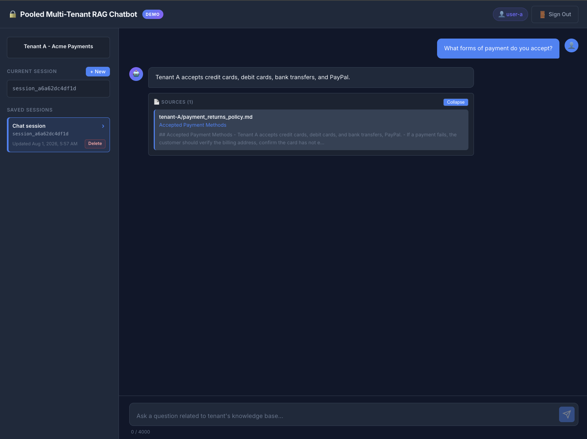
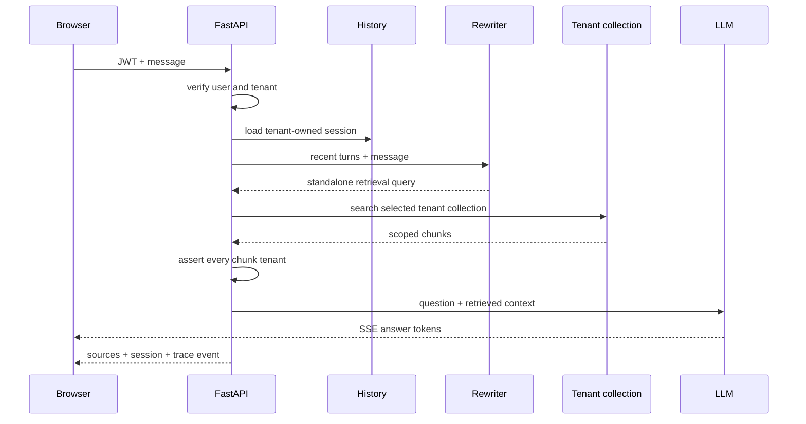

# Project 1 · Multi-Tenant RAG Chatbot


A simple FastAPI + LangChain application where every operation is securely isolated per tenant (customer or organization).

Authentication sets the tenant identity, and all subsequent operations — document retrieval, conversation history, and session management — strictly enforce that boundary, in summary:

1. **Established by Authentication, Not Prompting**: The `tenant_id` comes strictly from the user's verified JWT token at the API/FastAPI layer (`deps.py`). The model is never asked "Who is the tenant?" nor can a user say "Act as Tenant B" to override it.
2. **Enforced outside the LLM**: The application handles data filtering (retrieving documents from Chroma filtered by `tenant_id`) before sending context to the model, and enforces session ownership checks before saving history.
3. **LLM focus**: The LLM's sole responsibility is generating a coherent response based strictly on the pre-filtered, authorized context provided to it. It has no awareness or control of multi-tenancy boundaries.

## How Tenant Isolation Works

This project implements a **Pooled Multi-Tenant Architecture**, serving all tenants from a single application server with strict code-level boundaries:

1. **Single Application Server**: One FastAPI instance handles all requests without running separate processes or containers per tenant.
2. **JWT-Derived Identity**: User identity (`tenant_id`) is extracted directly from verified authentication tokens (JWTs) in `deps.py`. Users cannot override or pass a tenant ID in the request body.
3. **Filtered Vector Search**: Document search in `chat.py` queries a shared Chroma vector database filtered by `tenant_id`, and explicitly checks every retrieved chunk to prevent data leakage across tenants.



## Key Features

- **Strict Tenant Security**: All data access is scoped to the user's tenant. Attempting to view another tenant's session returns a `404 Not Found`.
- **Safe Document Retrieval**: Vector searches filter results by tenant metadata and verify each document chunk before passing context to the model.
- **Smart Follow-up Questions**: Automatically rephrases follow-up user questions using past chat context, with a safe fallback to the original question if rewriting fails.
- **Real-Time Streaming**: Streams AI responses token-by-token using Server-Sent Events (SSE), followed by source citations.
- **Observability**: Supports LangSmith tracing to track execution, run metadata, and tenant interactions.
- **OpenAI-Only Runtime**: Uses live OpenAI embeddings and chat models; startup requires a valid `OPENAI_API_KEY`.

> **Note**: Tenant identity is managed entirely by the application server. The AI model only answers questions based on pre-filtered context — it never decides or manages tenant access permissions.

## Request Flow



## Quickstart (Run Locally)

### Prerequisites

- Python 3.13+
- [`uv`](https://docs.astral.sh/uv/) package manager

### 1. Installation & Environment Setup

```bash
uv sync --all-extras
cp .env.example .env
```

### 2. Start the Server

Add a valid `OPENAI_API_KEY` and `JWT_SECRET_KEY` to `.env`, then start the server:

```bash
uv run uvicorn app.main:app --host 127.0.0.1 --port 8000
```

Startup fails if `OPENAI_API_KEY` is missing or still contains the placeholder value from
`.env.example`. The application does not provide an offline model fallback.

### 3. Open the Application

Navigate to `http://127.0.0.1:8000` in your browser and log in with either test user:

- **Tenant A**: `user-a` / `password-a`
- **Tenant B**: `user-b` / `password-b`

### Configuration Options (`.env`)

```dotenv
QUERY_REWRITE_ENABLED=true
QUERY_REWRITE_MODEL=gpt-5-mini
CHROMA_PERSIST_DIRECTORY=.local/chroma
LANGSMITH_TRACING=true
LANGSMITH_API_KEY=...
LANGSMITH_PROJECT=multi-tenant-rag
```

_(LangSmith tracing is optional. If no key is provided, trace events log locally.)_

## API Usage Example

### 1. Authenticate to get an access token

```bash
curl -X POST http://127.0.0.1:8000/api/auth/token \
  -H "Content-Type: application/x-www-form-urlencoded" \
  -d "username=user-a&password=password-a"
```

### 2. Send a chat request (Streamed Response)

```bash
curl -N -X POST http://127.0.0.1:8000/api/chat \
  -H "Content-Type: application/json" \
  -H "Authorization: Bearer <your_access_token>" \
  -d '{"message":"How long does an approved refund take?"}'
```

The response streams as Server-Sent Events (SSE):

1. `metadata`: Session ID and request details.
2. `token`: Individual tokens of the AI's response.
3. `sources`: Citations showing exact document paths, headings, and excerpts used.
4. `done`: Signals completion.

## Testing & Quality Evidence

Run tests and style checks:

```bash
uv run pytest tests -v --cov=app --cov-report=term-missing
uv run ruff check app tests
```

- **Test Suite**: 70 passing tests with 74% line coverage.
- **API-free automation**: Tests clear the singleton OpenAI credential and inject model or
  embedding doubles wherever inference behavior is exercised.
- **Coverage Areas**: Token verification, cross-tenant isolation, session privacy, citation filtering, query rewriting fallbacks, and streaming contracts.
- **Retrieval Performance**: Query rewriting improves top-1 retrieval recall from **75% to 87.5%** (evaluated in [Project 3](../3-Multi-Tenant-Evals/) and the [retrieval ablation notebook](../output/jupyter-notebook/per-tenant-retrieval-ablation.ipynb)).

## Recommended Production Upgrades

To move this implementation to enterprise production:

- **Authentication**: Integrate a managed identity provider (e.g., Auth0, AWS Cognito) with asymmetric key rotation.
- **Database**: Upgrade from SQLite to PostgreSQL with Row-Level Security (RLS).
- **Vector Database**: Use a cloud vector database (e.g., Pinecone, Qdrant) with tenant-isolated indexes.
- **Infrastructure**: Implement API rate limiting, automated tenant data deletion workflows, and centralized log aggregation.
