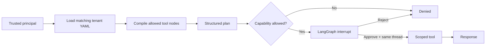

# Project 4 · Tenant-Configurable Orchestration


The 4-Tenant-Configurable-Orchestration project moves multi-tenant security and capability scoping directly into the agent graph compilation and execution layer using LangGraph.

Rather than relying on LLM system prompts to enforce tenant boundaries, it dynamically compiles an isolated graph for each authenticated tenant based on declarative configuration files.

### Core Mechanics & Features

1. Declarative Per-Tenant YAML Configuration (config/)

Each tenant has a dedicated agent.yaml file declaring:

- `persona`: System prompt role / behavioral context.
- `allowed_tools`: Explicit list of executable tools permitted for the tenant.
- `guardrails`: Operational boundaries and data restrictions.
- `require_plan_approval`: Enables Human-in-the-Loop (HITL) verification before tool execution.

Example:

- `Tenant A`: Allowed tools = [`query_orders`, `query_rag`]
- `Tenant B`: Allowed tools = [`query_rag`, `calculator`]

2. Structural Graph Isolation `(orchestration/graph.py)`

   When an authenticated Principal makes a request:
   1. The app loads only the authenticated tenant's YAML file.
   2. It dynamically compiles a LangGraph `StateGraph` containing only tool nodes matching `allowed_tools`.
   3. If an LLM planner attempts to invoke an unauthorized tool (e.g., Tenant B attempting to access `query_orders`), the `enforce_capabilities` node blocks execution before any approval or tool node is reached.

3. Human-in-the-Loop (HITL) Plan Approval
   - Uses LangGraph's `interrupt()` and `InMemorySaver` checkpointer to pause execution after structured planning.
   - The reviewer inspects the planned action, rationale, and arguments against tenant guardrails.
   - Resumes execution via `Command(resume={"approved": ...})`
     on the checked-in thread ID. Tools only execute after approval, preventing duplicate or unvetted side effects.

Normal workflow construction uses a live OpenAI model for structured planning and final answer
generation and fails fast without `OPENAI_API_KEY`. Automated tests inject deterministic
planner and response doubles; there is no offline runtime setting.

Tenant A can query orders and RAG. Tenant B can query RAG and use a bounded calculator. When
Tenant B asks for an order, `query_orders` is absent from its compiled graph and the request is
denied before approval or execution. The boundary therefore does not depend on a prompt asking
the model to behave.

## Flow



LangGraph's `InMemorySaver` checkpoints the interrupted state. Resume uses
`Command(resume=...)` with the same thread ID. Tool work happens only after the interrupt, so
resume cannot duplicate a side effect.

## Run it

```bash
uv sync --all-extras
cp .env.example .env
# Set OPENAI_API_KEY in .env before running tenant-workflow.
uv run pytest -v
uv run ruff check orchestration tests
uv run mypy orchestration

uv run tenant-workflow \
  --tenant tenant-A \
  --query "Show order A-1001" \
  --approve
```

The deterministic injected-double suite inspects
the compiled node set for each tenant, proves forbidden capabilities are rejected before an
interrupt, verifies approval and rejection resumes on the same thread, checks that no tool work
happens before approval, and tests configuration/directory tenant mismatches.

The CLI's `--tenant` flag stands in for an already verified identity during this local demo.
In an HTTP service, it must be removed from user-controlled input and populated from verified
token claims, as Projects 1 and 2 demonstrate.

## Design decisions

- Pydantic rejects unknown config fields, duplicate capabilities, and config/directory tenant
  mismatches.
- The live OpenAI planner returns a validated `Plan`, not an unstructured tool string.
- Forbidden tools are not registered as graph nodes for that tenant.
- All tools require tenant scope as a separate function argument; model-controlled arguments
  cannot select it.
- The checked-in tools are deterministic and read-only; tests inject both model collaborators
  and require no OpenAI key.

For production, replace the in-memory checkpointer with a tenant-keyed PostgreSQL checkpointer,
derive `Principal` only from a verified audience-bound token, sign/version agent configs, and
send review interrupts through an authenticated approval UI.
