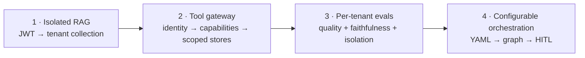
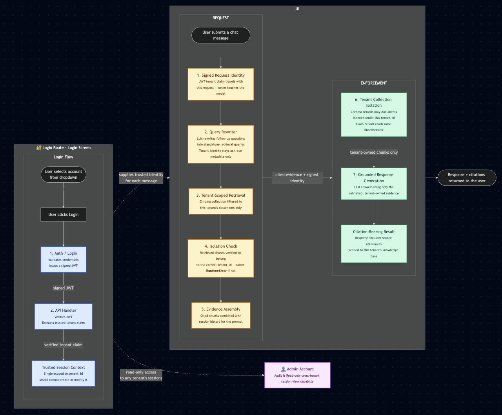
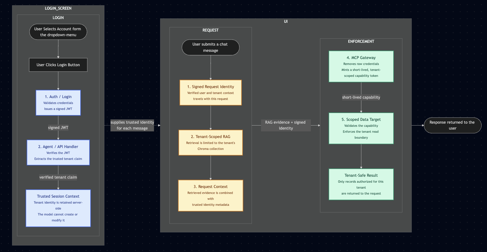
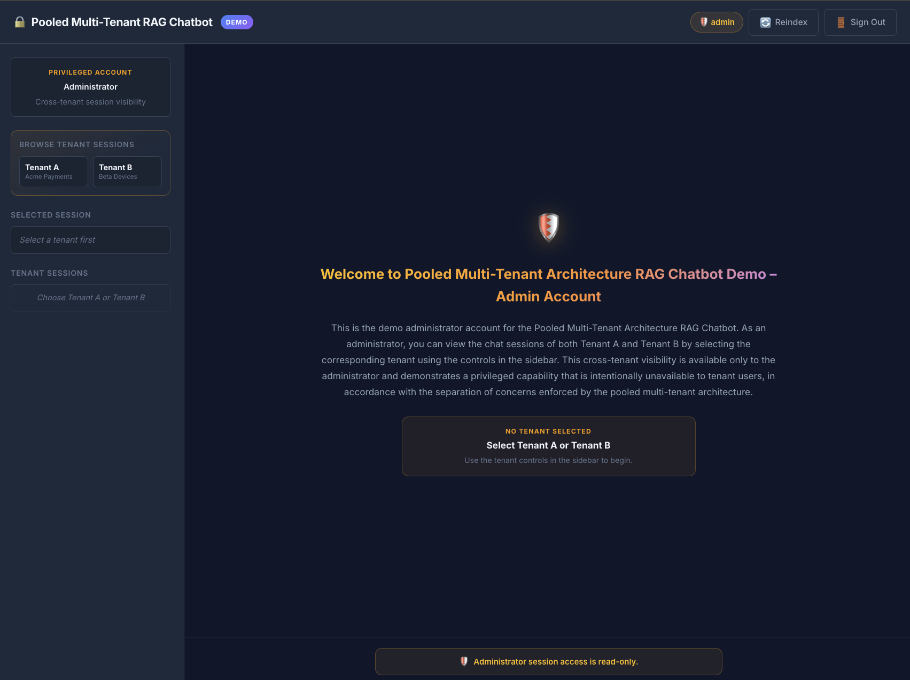
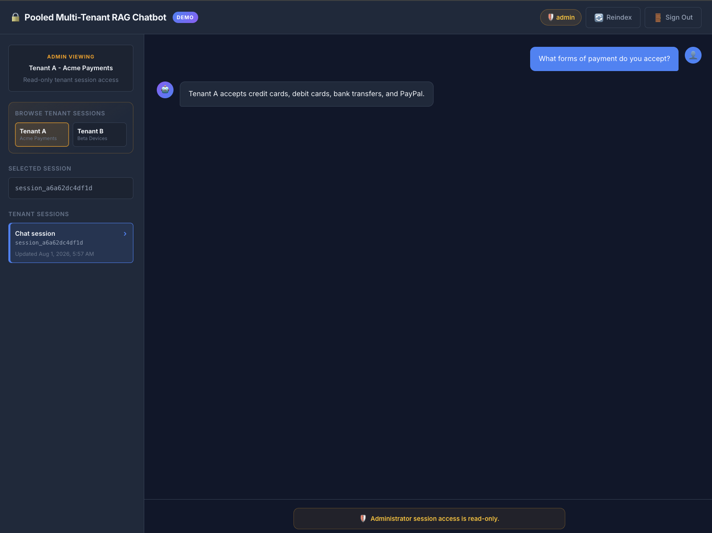
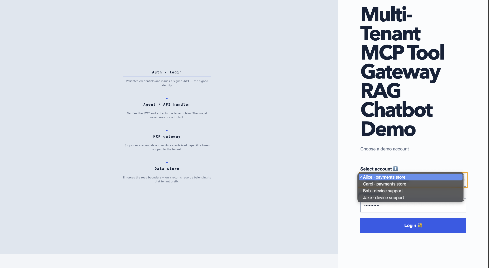
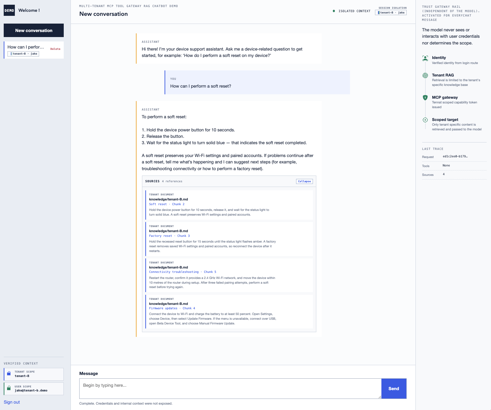
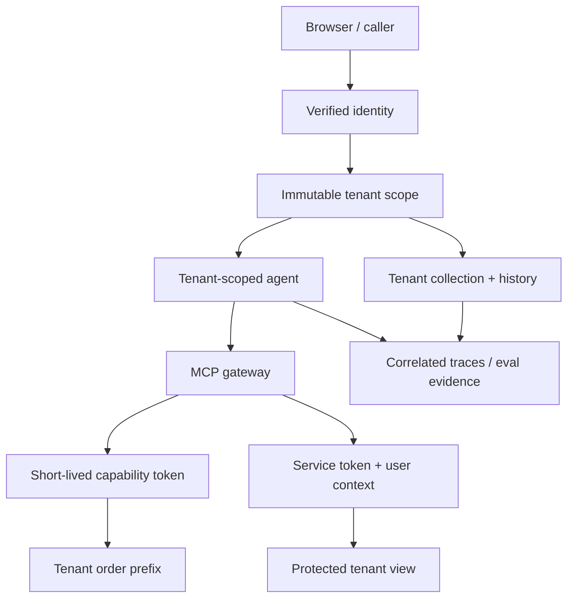

# Multi-Tenant AI Systems Portfolio


Four progressively deeper projects explore one question: **how do you make AI systems
tenant-aware without trusting the model to enforce the boundary?**

The portfolio starts with a simple case of isolated retrieval, moves identity through a capability-scoped MCP
gateway, makes quality measurable per tenant, and finally makes the agent graph itself
tenant-configurable. All four projects intentionally require live OpenAI models in their normal
runtime paths; automated tests inject model and embedding doubles so security and isolation
checks do not consume API calls.

## The engineering arc



| Project                                                          | Primary question                                                                         | Result                                                                                                                                                     | Evidence                                                                            |
| ---------------------------------------------------------------- | ---------------------------------------------------------------------------------------- | ---------------------------------------------------------------------------------------------------------------------------------------------------------- | ----------------------------------------------------------------------------------- |
| [1 · Multi-Tenant RAG](1-Multi-Tenant-Simple/)                   | Can retrieval and history remain isolated while conversational queries are rewritten?    | Yes - each login is JWT-bound to a tenant collection; rewritten queries never retrieve documents from another tenant's store.                              | 70 tests, 74% coverage, JWT ownership checks, traced rewrite/retrieval/generation   |
| [2 · MCP Tool Gateway](2-Multi-Tenant-MCP-Tool-Gateway/)         | Can identity safely cross an agent, gateway, token-vending, and data-store chain?        | Yes - short-lived capability tokens replace raw credentials at every hop; 10/10 gateway evals confirm the full chain enforces tenant scope.                | 53 tests, 86% coverage, 10/10 full-stack evals, streamed agent events               |
| [3 · Per-Tenant Evals](3-Multi-Tenant-Evals/)                    | Can quality regressions be measured without hiding tenant asymmetry in a global average? | Yes - per-tenant scoring exposes a 75% vs. 100% recall gap that a blended average would conceal, proving contextual rewrite helps unevenly across tenants. | Contextual rewrite improves top-1 recall from 75% to 87.5%; 100% isolation          |
| [4 · Tenant Orchestration](4-Tenant-Configurable-Orchestration/) | Can tool capability be enforced by graph construction instead of a prompt?               | Yes - forbidden tools are absent from each tenant's compiled graph, so no prompt injection can invoke them; HITL interrupts surface at the right nodes.    | Structured plans, real LangGraph interrupts, forbidden tools absent from each graph |

## Usage Scenario Comparison

| Project                                                          | When to reach for it                                                                                          | Best-fit use cases                                                                                            | Why it fits                                                                                                                          |
| ---------------------------------------------------------------- | ------------------------------------------------------------------------------------------------------------- | ------------------------------------------------------------------------------------------------------------- | ------------------------------------------------------------------------------------------------------------------------------------ |
| [1 · Multi-Tenant RAG](1-Multi-Tenant-Simple/)                   | You need a stateful conversational search layer over per-tenant document stores, deployed quickly.            | Internal knowledge bases, per-customer support bots, document Q&A with session history.                       | JWT-scoped retrieval and query rewriting are the minimum viable isolation primitive; easiest to audit and extend.                    |
| [2 · MCP Tool Gateway](2-Multi-Tenant-MCP-Tool-Gateway/)         | Agents must call external or privileged tools and you cannot trust raw credentials to travel through prompts. | Agentic assistants with API integrations, multi-system orchestrators, regulated environments requiring audit. | Capability tokens replace secrets at every hop; the gateway log gives a complete, tenant-tagged audit trail without model trust.     |
| [3 · Per-Tenant Evals](3-Multi-Tenant-Evals/)                    | You need to catch retrieval or quality regressions before they ship, tracked separately per tenant.           | CI quality gates, retrieval tuning experiments, SLA-per-tenant reporting, chunking strategy comparisons.      | Per-tenant scoring surfaces asymmetric degradation that aggregate metrics hide; integrates with the ablation notebook.               |
| [4 · Tenant Orchestration](4-Tenant-Configurable-Orchestration/) | Tool permissions must be encoded in graph topology, not in prompt instructions, and may vary per tenant.      | Workflow automation with role-based tool access, human-in-the-loop approval chains, YAML-driven onboarding.   | Graph construction is the enforcement point; forbidden tools never appear in a tenant's graph regardless of what the model requests. |

## Sessions scoping across projects

| Project                                                          | UI Label       | Python / API Identifier | DB / State Isolation                                     | Rationale                                                                                                                                                                       |
| ---------------------------------------------------------------- | -------------- | ----------------------- | -------------------------------------------------------- | ------------------------------------------------------------------------------------------------------------------------------------------------------------------------------- |
| [1 · Multi-Tenant RAG](1-Multi-Tenant-Simple/)                   | "session"      | `session_id`            | `WHERE session_id = ? AND tenant_id = ?`                 | **Single-scoped.** Sufficient for generic tenant knowledge retrieval where all authenticated users of a tenant share the same trust level.                                      |
| [2 · MCP Tool Gateway](2-Multi-Tenant-MCP-Tool-Gateway/)         | "conversation" | `session_id`            | `WHERE session_id = ? AND tenant_id = ? AND user_id = ?` | **Dual-scoped.** Two demo users per tenant make the boundary visible: colleagues share tenant RAG/tool data but cannot read each other's private conversation history.          |
| [3 · Per-Tenant Evals](3-Multi-Tenant-Evals/)                    | N/A (CLI)      | `case_id`               | In-memory dataset split by `tenant_id`                   | **Stateless batch runs.** Evaluates historical context statically; tracks progress by test case ID within tenant-partitioned splits instead of interactive sessions.            |
| [4 · Tenant Orchestration](4-Tenant-Configurable-Orchestration/) | "thread"       | `thread_id`             | LangGraph checkpointer scoped by `tenant_id`             | **Graph state persistence.** Uses LangGraph's `thread_id` to persist workflow state across human-in-the-loop pauses, with tool capability constrained by the tenant's topology. |

## Architecture Overview

### Project 1 · Multi-Tenant Simple Architecture



The below flowchart illustrates Single-scoped architecture, sufficient for generic tenant knowledge retrieval where all authenticated users of a tenant share the same trust level:

1. **Login and authentication:** On the login screen, the user selects an account and clicks the Login button. The authentication service validates the supplied credentials and issues a signed JWT.

2. **Tenant session establishment:** The API handler verifies the JWT, extracts the trusted `tenant_id` claim, and creates a tenant-scoped server-side session. The model cannot create, alter, or override this identity.

3. **Message submission:** After the user gains access to the chat interface, each submitted message starts a new inference request. The trusted tenant identity is attached to the request as backend-controlled metadata and is not exposed to the model.

4. **Query rewriting:** When necessary, the language model rewrites a follow-up question into a standalone retrieval query. The tenant identity remains separate from the rewritten text and is used only by the trusted application layer to control access.

5. **Tenant-scoped retrieval:** The rewritten query is sent to Chroma, where retrieval is restricted to the document collection associated with the verified `tenant_id`.

6. **Isolation validation:** The application verifies that every retrieved chunk belongs to the expected tenant. If content from another tenant is detected, the request is stopped and a `RuntimeError` is raised.

7. **Evidence assembly:** The validated, tenant-owned chunks are combined with the relevant session history and source information to form the evidence supplied to the response-generation prompt.

8. **Tenant boundary enforcement:** This project does not use an external gateway. Instead, isolation is enforced through the verified JWT tenant claim, tenant-specific Chroma collections, and the additional runtime ownership check.

9. **Grounded response generation:** The language model generates its answer using only the retrieved evidence belonging to the verified tenant. The result includes citations that refer to sources within that tenant’s knowledge base.

10. **Response delivery:** The final answer and its citations are returned to the user through the chat interface.

11. **Administrative access:** An optional administrator account can inspect session history across tenants for audit purposes. This access is read-only and remains separate from the normal tenant-scoped inference path.

### Project 2 · MCP Tool Gateway



The below flowchart illustrates how tenant identity and data isolation are enforced from login through each chat interaction:

1. **Login and identity establishment:** On the login screen, the user selects an account and clicks the Login button. The authentication service validates the credentials and issues a signed JWT.

2. **Tenant context creation:** The API handler verifies the JWT, extracts the trusted tenant claim, and establishes a server-side session context. This tenant identity is controlled by the trusted application layer and cannot be created or modified by the model.

3. **Message submission:** After access to the chat interface is granted, the user submits a message. The backend verifies the request and derives the trusted user and tenant context for that specific interaction.

4. **Tenant-scoped retrieval:** The request is routed to the tenant-specific Chroma collection, ensuring that document retrieval is limited to content belonging to the verified tenant.

5. **Request context assembly:** The retrieved evidence is combined with the trusted identity metadata to create the context required for the request.

6. **MCP gateway enforcement:** The request is passed to the MCP gateway, which keeps raw credentials outside the model context and issues a short-lived capability token scoped to the verified tenant.

7. **Scoped data access:** The target data store validates the capability token, enforces the tenant read boundary, and returns only records the tenant is authorized to access.

8. **Response generation:** The tenant-safe result is used to generate the final response, which is then returned to the user.

## Architecture Comparison 🔎

`Why the MCP Tool Gateway architecture is superior?`

Project 1 proves that tenant isolation is achievable with a JWT and a per-tenant Chroma collection. Project 2 asks a harder question: what happens when the agent needs to call external or privileged tools, not just retrieve documents?

1. `Credentials never cross the trust boundary`

   In Project 1 the JWT is the credential, and it travels as far as the RAG retrieval step. If the isolation check were to fail silently, raw documents could reach the model. The boundary is a runtime assertion.

   In Project 2 the gateway intercepts every tool call and replaces the raw credential with a short-lived, tenant-scoped capability token. The token expires. The model never receives, sees, or forwards the original credential. Even if the model were compromised, it could not extract anything useful.

2. `Isolation is enforced before data is read, not after`

   Project 1 retrieves chunks first, then verifies their tenant_id metadata. A misconfigured Chroma collection could return wrong-tenant data and the check is the last line of defence.

   Project 2 enforces the tenant boundary at the gateway, before the data store is contacted. The data store sees only a scoped capability token and returns only records that match - the model never has the opportunity to receive cross-tenant data even transiently.

3. `Individual-level privacy within a tenant`
   Project 1 scopes sessions to tenant_id only. All users of a tenant share the same trust level - one user's sessions are structurally accessible to another user of the same tenant.

   Project 2 adds user_id as a second dimension. Alice and Carol both belong to tenant-A but cannot see each other's conversations. This is essential in any real deployment where colleagues share a platform.

4. `Agentic tool access without raw credential exposure`
   Project 1 is a retrieval system. Project 2 is an agent that can call privileged tools (order lookups, property queries). Without the gateway, the agent would need raw API credentials in its context to make those calls - a fundamental prompt-injection risk. The capability token model makes this safe.

5. `Complete, tenant-tagged audit trail`
   The MCP gateway logs every tool call with the tenant identity attached, independently of the model. In Project 1, the only audit signal is the CRITICAL log on an isolation error. Project 2 produces a full, continuous audit trail whether or not anything goes wrong.

In summary:

    - Project 1 is the minimum viable isolation primitive - correct and auditable for document Q&A.

    - Project 2 is the architecture required the moment the agent needs to act, not just retrieve, because it moves enforcement outside the model entirely and makes credential exposure structurally impossible rather than just unlikely.

## Visual proof

### Project 1 - grounded, citation-bearing RAG


The JWT determines the tenant. The tenant selector is display-only after authentication, and
the citation panel exposes the tenant-scoped source used for the response.

### Project 1 - Admin Account Interface View and separation of concerns

<table>
<tr>
<td align="center" width="50%">



1.The admin interface shows the default view for the admin account.

</td>
<td align="center" width="50%">



2. The admin account allows browsing each tenant's session and chat history, clearly maintaining isolation between tenants.

</td>
</tr>
</table>

## Project 2

### Project 2 - streamed agent answer with trust evidence



The UI streams safe agent phases and answer tokens while the trust rail shows the tools and
sources actually used. Raw credentials, internal headers, and chain-of-thought are never sent
to the browser. Saved conversations use an inline delete confirmation, backed by tenant- and
user-scoped ownership checks. Repeated tenant/user scope envelopes on the session card,
identity footer, and chat header make that dual ownership visible.



Multi-Tenant MCP Tool Gateway RAG Chatbot Demo: Tenant-isolated device-support conversation showing a soft-reset response grounded in tenant-B knowledge-base sources, with verified user and tenant context, scoped retrieval, gateway protections, and trace details confirming that credentials remain hidden from the model.

## Architecture and trust model



The common invariant is that tenant identity is derived from verified application context and
passed separately from model-controlled text. Prompts can influence the requested action, but
they cannot select a tenant, mint a capability, register a forbidden tool, or choose a backing
collection.

## Measured results

These are local, reproducible results from injected test-double paths-not claims about
production model quality. Normal application and CLI runs use live OpenAI models.

| Check                                               |                    Result |
| --------------------------------------------------- | ------------------------: |
| Application and workflow tests                      |            **137 passed** |
| Project 2 gateway evaluation                        |   **10 / 10 exact match** |
| Project 3 raw-query top-1 retrieval recall          |         **75.0% overall** |
| Project 3 contextual-rewrite top-1 retrieval recall |         **87.5% overall** |
| Project 3 faithfulness / isolation                  |           **100% / 100%** |
| Project 1 / 2 / 3 / 4 line coverage                 | **74% / 86% / 82% / 75%** |

Project 3 deliberately reports per-tenant scores: the candidate reaches 75% recall on Tenant A
and 100% on Tenant B. That asymmetry is useful evidence, not a number to average away. See the
[full per-case report](3-Multi-Tenant-Evals/reports/latest.json), the
[gateway evaluation report](2-Multi-Tenant-MCP-Tool-Gateway/evaluations/results/latest.json),
and the executed [retrieval ablation notebook](output/jupyter-notebook/per-tenant-retrieval-ablation.ipynb).

## Run the portfolio

Each folder is an independent `uv` project. Every normal application or CLI run requires live
OpenAI credentials. Project 1 starts with:

```bash
cd 1-Multi-Tenant-Simple
uv sync --all-extras
cp .env.example .env
# Set OPENAI_API_KEY and JWT_SECRET_KEY in .env
uv run uvicorn app.main:app --host 127.0.0.1 --port 8000
```

Then open `http://127.0.0.1:8000` and sign in as `user-a` / `password-a` or
`user-b` / `password-b`.

For the security-focused gateway:

```bash
cd 2-Multi-Tenant-MCP-Tool-Gateway
uv sync --all-extras
cp .env.example .env
# Set OPENAI_API_KEY in .env
uv run uvicorn app.main:app --host 127.0.0.1 --port 8000
```

Use `alice@tenant-a.demo` / `alice-demo` or `bob@tenant-b.demo` / `bob-demo`.
Projects 3 and 4 likewise provide `.env.example` files for `tenant-evals` and
`tenant-workflow`. Project-specific READMEs contain model setup, API contracts, test commands,
and design trade-offs. GitHub Actions validates all four projects independently with injected
test doubles and no OpenAI secret.

## Quality, observability, and analysis

- Project 1 attaches stable run names, tags, tenant metadata, session correlation, and component
  metadata to LangChain runnable configs. Setting the standard LangSmith environment variables
  enables remote traces; local `rag_events` remain available without an external account.
- Project 2 correlates audit events across the agent, MCP gateway, token vending, protected
  stores, tool selection, and sources. The browser receives only a safe projection.
- Project 3 checks retrieval recall, expected-answer coverage, lexical faithfulness, and
  isolation for each tenant before computing an aggregate; CI injects deterministic inference
  collaborators while normal evaluation runs use OpenAI.
- The executed notebook compares heading-aware chunks with fixed windows and overlap settings
  per tenant, demonstrating that one retrieval configuration need not be optimal for both.

## Production boundaries

The repository is intentionally runnable on one machine. A production version would replace
embedded identity, fakeredis, SQLite policy emulation, in-memory Chroma/checkpointing, and local
secrets with managed identity, Redis ACLs, PostgreSQL RLS, persistent vector/checkpoint stores,
central secret management, rate limits, and reviewed deployment controls.

There is no public deployment because the checked-in demo credentials and local security
substitutes should not be exposed unchanged. There is also no fabricated LangSmith screenshot:
the integration is wired and testable, but external telemetry should be demonstrated only from
a real account.
